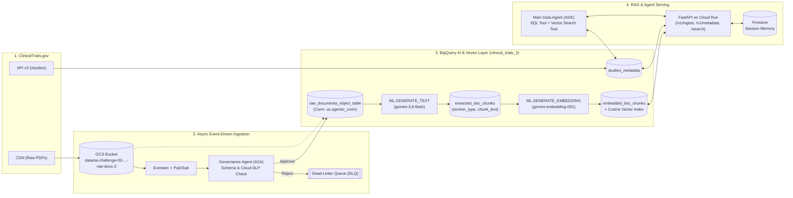

# Autonomous Agentic Data Pipeline Architecture

## 1. End-to-End Architecture Diagram

2. Unstructured-to-Structured Flow
GCS & Object Table: Raw PDFs land in gs://data4ai-challenge-03-agentic-data-engineering-raw-docs-2/raw/. The BigQuery Object Table (raw_documents_object_table) catalogs these files via the data4ai-challenge-03.us.agentic_conn connection.

Multimodal Section Extraction: ML.GENERATE_TEXT invokes gemini-3.8-flash directly over the Object Table URIs, extracting structured clinical sections (Study Overview, Inclusion Criteria, Exclusion Criteria, Primary Endpoints, Dosing & Intervention) and unnesting them into extracted_doc_chunks.

Vector Indexing: ML.GENERATE_EMBEDDING calls gemini-embedding-001 to embed each section chunk into embedded_doc_chunks, indexed with CREATE VECTOR INDEX (COSINE distance).

3. Why Asynchronous Ingestion (Eventarc + Pub/Sub)?
Non-Blocking Latency: Multimodal PDF extraction and DLP inspection take several seconds per document. Asynchronous ingestion returns HTTP 202 Accepted immediately while processing files in the background.

Rate-Limit Buffering & Backpressure: Pub/Sub absorbs burst uploads and protects Vertex AI quotas (gemini-3.8-flash and gemini-embedding-001), routing corrupted or policy-violating files to a Dead-Letter Queue (DLQ).