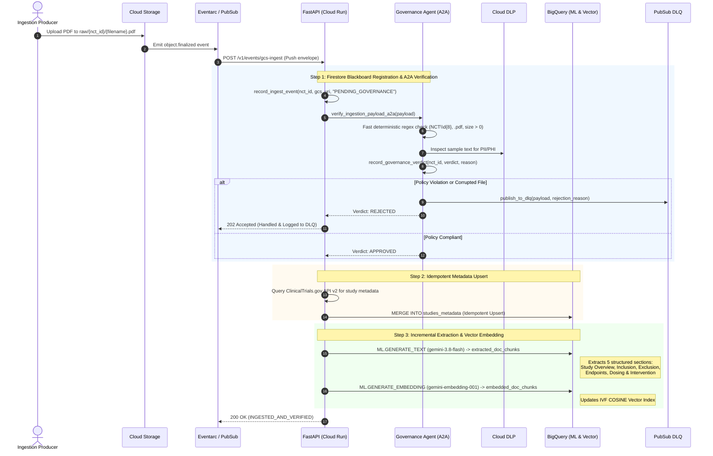

# Autonomous Agentic Data Pipeline Architecture

> **System Overview:** A cloud-native, event-driven data engineering and agentic RAG platform built on Google Cloud Platform. The system processes unstructured clinical protocol documents (PDFs from ClinicalTrials.gov), transforms them into structured relational metadata and vector embeddings in BigQuery, and provides an autonomous conversational Data Agent deployed on Vertex AI Agent Engine.

---

## 1. End-to-End System Architecture

```mermaid
flowchart TD
    subgraph Sources["1. Ingestion Sources"]
        CT_API["ClinicalTrials.gov API v2\n(/studies/{nct_id})"]
        CT_CDN["ClinicalTrials.gov CDN\n(Protocol / SAP PDFs)"]
        USER["End User / Clinical Researcher"]
    end

    subgraph Storage["2. Raw Document Lakehouse"]
        GCS[("Cloud Storage (GCS)\ngs://...-raw-docs-2/raw/{nct_id}/")]
        EV["Eventarc Trigger\n(google.cloud.storage.object.v1.finalized)"]
        PS["Pub/Sub Ingest Topic\n(clinical-trials-ingest-topic)"]
    end

    subgraph Governance["3. A2A Governance & DLQ Layer"]
        GOV["Governance Agent (A2A)\n(clinical_trials_governance_agent)"]
        DLP["Cloud DLP\n(InfoTypes: SSN, NPI, Name, Email)"]
        DLQ[["Dead-Letter Queue (DLQ)\n(clinical-trials-ingest-dlq)"]
    end

    subgraph BigQuery["4. BigQuery AI & Vector Store (clinical_trials_2)"]
        OBJ[("BigQuery Object Table\n(documents_table via us.agentic_conn)")]
        META[("studies_metadata\n(Idempotent MERGE upsert)")]
        EXT["BigQuery ML.GENERATE_TEXT\n(model_extractor: gemini-3.8-flash)"]
        CHUNKS[("extracted_doc_chunks\n(section_type, chunk_text)")]
        EMB["BigQuery ML.GENERATE_EMBEDDING\n(embedding_model: gemini-embedding-001)"]
        VEC[("embedded_doc_chunks\n+ IVF Cosine Vector Index")]
    end

    subgraph Serving["5. Hybrid Serving & Blackboard State Layer"]
        FASTAPI["FastAPI on Cloud Run\n(POST /search, GET /metadata, POST /v1/chat)"]
        FS[("Cloud Firestore Blackboard\ndb: clinical-trials-agents-sessions-db\ningest_records/{nct_id}\ngovernance_verdicts/{nct_id}")]
        RUNTIME["Vertex AI Agent Engine (Agent Runtime)\n(ADK AdkApp: native sessions + root_agent + callbacks)"]
    end

    subgraph Telemetry["6. Observability & FinOps"]
        TRACE["Google Cloud Trace\n(Agent Engine OTLP / Ambient ADK Spans)"]
        LOGS["Cloud Logging & Monitoring\n(Distribution: agent_session_total_tokens, latency)"]
    end

    %% Ingestion Flow
    CT_CDN -->|Download PDF| GCS
    GCS -->|Object Finalized| EV --> PS --> FASTAPI
    FASTAPI -->|record_ingest_event| FS
    FASTAPI -->|A2A Handshake| GOV
    GOV -->|Scan PII| DLP
    GOV -->|record_governance_verdict| FS
    GOV -->|Reject Violation| DLQ
    GOV -->|Approve| CT_API
    CT_API -->|Resolve Metadata| META
    GCS -.->|Metadata Pointer| OBJ
    OBJ --> EXT --> CHUNKS --> EMB --> VEC

    %% Serving & Query Flow
    USER -->|Chat Prompt| RUNTIME
    USER -->|API Query| FASTAPI
    FASTAPI <--> FS
    FASTAPI <-->|VECTOR_SEARCH| VEC
    RUNTIME -->|sub_agents| GOV
    RUNTIME -->|execute_clinical_sql| META
    RUNTIME -->|search_clinical_protocols| FASTAPI
    RUNTIME -->|get_governance_verdict| FS

    %% Telemetry Flow
    FASTAPI -.-> LOGS
    FASTAPI -.-> TRACE
    RUNTIME -.-> TRACE
    RUNTIME -.-> LOGS
```

---

## 2. Ingestion & Transformation Sequence (Unstructured to Structured)



---

## 3. Serving Architecture: Cloud Run + Vertex AI Agent Engine

The serving layer utilizes a dual-engine architecture:

### 3.1 FastAPI on Cloud Run (`clinical-trials-rag-api`)
- **Container Runtime**: Linux container running Uvicorn + FastAPI on port `8080`.
- **Responsibilities**:
  1. **Ingestion Ingress**: Exposes `POST /v1/ingest` and the Eventarc push webhook `POST /v1/events/gcs-ingest`.
  2. **Metadata API**: Exposes `GET /v1/metadata/{id}` joined with BigQuery chunk counts.
  3. **High-Performance Semantic Vector Search**: `POST /search` executes parameterized BigQuery `VECTOR_SEARCH` queries using pre-warmed database connections and async worker threads (`asyncio.to_thread`).
  4. **Agent Gateway Proxy**: `POST /v1/chat` bridges standard HTTP/REST clients to Vertex AI Agent Engine.

### 3.2 Vertex AI Agent Engine (Agent Runtime)
- **Framework**: `google.adk` (Agent Development Kit 2.0).
- **Packaging**: Initialized via `vertexai.agent_engines.AdkApp(agent=root_agent, enable_tracing=True)`.
- **Identity & Security (BYOSA)**: Runs under the dedicated service account `80080086039-compute@developer.gserviceaccount.com`.
- **Guardrails & Sub-Agents**:
  - `before_model_callback`: `pii_guardrail_before_model` redacts PII via Cloud DLP before prompts reach Gemini.
  - `after_model_callback`: `safety_response_monitor` logs safety finish reasons to the ambient OpenTelemetry span.
  - `before_tool_callback`: `sql_safety_before_tool` enforces `SELECT`/`WITH` read-only SQL before tool execution.
  - `sub_agents`: `[governance_agent]` enables live A2A delegation from `root_agent`.
  - `generate_content_config`: Enforces `VERTEX_SAFETY_SETTINGS`.
- **Hybrid Blackboard Memory & Sessions (Pattern A)**:
  - **Conversational History**: Managed natively by Vertex AI Agent Engine (`AdkApp` defaults), ensuring full Cloud Console Playground compatibility.
  - **Business & Governance State**: Persisted in Cloud Firestore (`clinical-trials-agents-sessions-db`) across `ingest_records/{nct_id}` and `governance_verdicts/{nct_id}` collections.
- **Dynamic Intent Routing**:
  - **Analytical Query**: Direct BigQuery SQL execution over `studies_metadata` via `execute_clinical_sql`.
  - **Conceptual Query**: Semantic retrieval over clinical protocols via `search_clinical_protocols` (calling Cloud Run `/search`).
  - **Hybrid Query**: Executes SQL filter to narrow trial cohorts, followed by semantic vector search to answer specific protocol questions.
  - **Governance Query**: Retrieves persisted ingestion verdicts via `get_governance_verdict` or delegates live validation to `clinical_trials_governance_agent`.

---

## 4. BigQuery AI & Vector Layer Design

The BigQuery dataset `clinical_trials_2` acts as the multimodal data lakehouse:

| Table / Object | Type | Description | Idempotency & Optimization Strategy |
| :--- | :--- | :--- | :--- |
| `documents_table` | External Object Table | References raw PDFs in `gs://.../raw/` via connection `us.agentic_conn`. | Auto-refreshes file catalog from GCS object store. |
| `studies_metadata` | Managed Native Table | Stores trial IDs, titles, status, and document references. | Upserted via BigQuery `MERGE` to prevent duplicate study rows on re-upload. |
| `model_extractor` | Remote ML Model | Vertex AI remote model endpoint (`gemini-3.8-flash`). | Uses structured prompting with `SAFE.PARSE_JSON` to segment PDFs into 5 clinical sections. |
| `extracted_doc_chunks` | Managed Native Table | Stores extracted sections (`nct_id`, `section_type`, `chunk_text`). | Incremental `INSERT` filtered with `WHERE gcs_uri NOT IN (...)` to prevent duplicate chunking. |
| `embedding_model` | Remote ML Model | Vertex AI text embedding model (`gemini-embedding-001`). | Generates 768-dimensional dense vectors. |
| `embedded_doc_chunks` | Managed Native Table | Stores chunk texts and vector embeddings (`ARRAY<FLOAT64>`). | Filtered by `chunk_id NOT IN (...)` to eliminate duplicate embedding API costs. |
| `doc_chunks_cosine_idx` | Vector Index | Inverted File (IVF) index with `COSINE` distance metric. | Accelerated sub-second approximate nearest neighbor (ANN) retrieval. |

---

## 5. AgentOps, Telemetry & FinOps Architecture

Observability is engineered to satisfy the Day 10 monitoring requirements:

### 5.1 Distributed Tracing (OpenTelemetry)
- Both Cloud Run and Vertex AI Agent Engine are instrumented with OpenTelemetry SDK.
- In Agent Runtime (`GOOGLE_CLOUD_AGENT_ENGINE_ID` / `GOOGLE_CLOUD_AGENT_ENGINE_LOCATION` detected), `agent/telemetry.py` preserves the host's native OTLP exporter to `telemetry.googleapis.com` instead of overwriting `TracerProvider`.
- Tools (`execute_clinical_sql`, `search_clinical_protocols`) and callbacks attach custom attributes (`clinical.row_count`, `clinical.chunks_retrieved`, `clinical.latency_ms`, `guardrail.*`) directly to the ambient ADK span and resolve `gen_ai.conversation.id` via `get_active_conversation_id()` so all spans correlate cleanly in Cloud Trace.
- Exported spans flow asynchronously into **Google Cloud Trace**, providing end-to-end waterfall visualization of:
  - Client HTTP Request $\rightarrow$ FastAPI Endpoint $\rightarrow$ BigQuery Query Execution $\rightarrow$ Cloud DLP Inspection.
  - User Prompt $\rightarrow$ Callbacks $\rightarrow$ Agent Thought $\rightarrow$ Tool Invocation $\rightarrow$ Model Generation.

### 5.2 Structured Cloud Logging & Metric Ingestion
- Zero-latency JSON payloads are written directly to `sys.stdout`. Cloud Run and Agent Runtime parse stdout streams into structured Cloud Logging entries under `jsonPayload`.
- Two Cloud Monitoring distribution metrics track performance:
  1. **`agent_session_total_tokens`**: Extracts `jsonPayload.total_tokens` grouped by `jsonPayload.session_id`.
  2. **`agent_execution_latency_ms`**: Extracts `jsonPayload.latency_ms` to generate p50, p90, and p95 latency distributions.

### 5.3 FinOps Cost Estimation Model
Execution costs are calculated on every interaction using published Gemini 3.8 Flash rates:
$$\text{Cost (USD)} = (\text{Prompt Tokens} \times \$0.000000075) + (\text{Response Tokens} \times \$0.00000030)$$
This enables real-time session cost auditing directly inside Cloud Logging dashboards.
